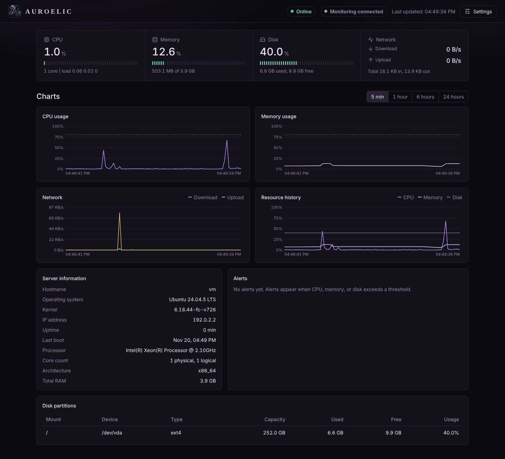
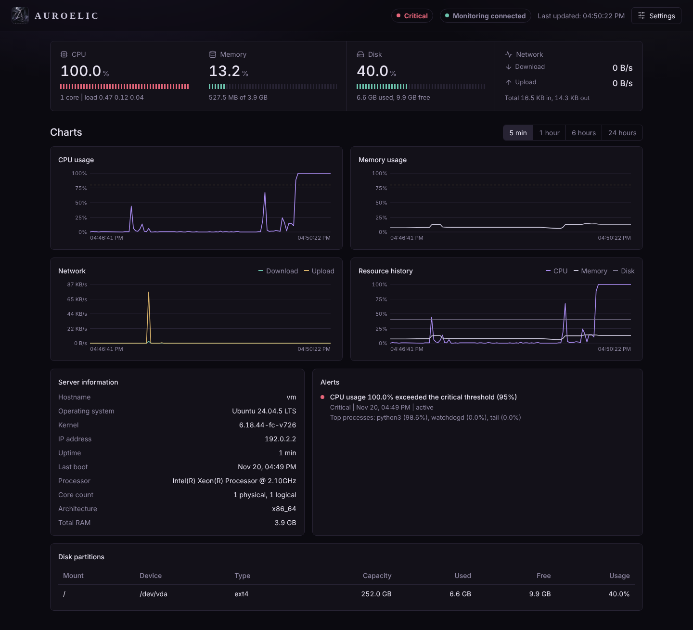
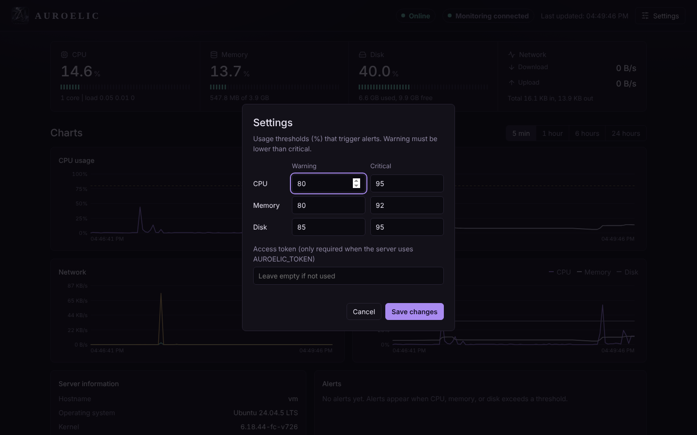
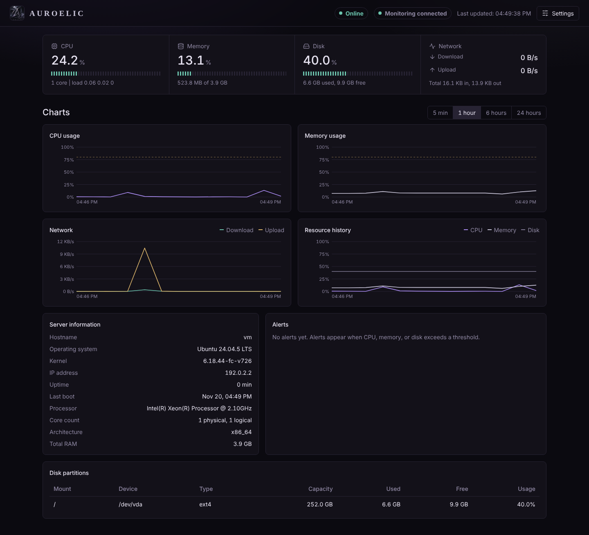
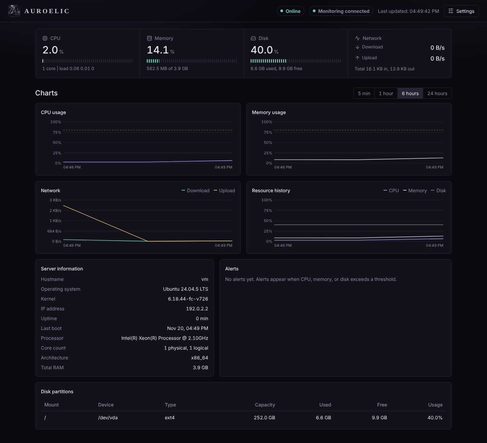
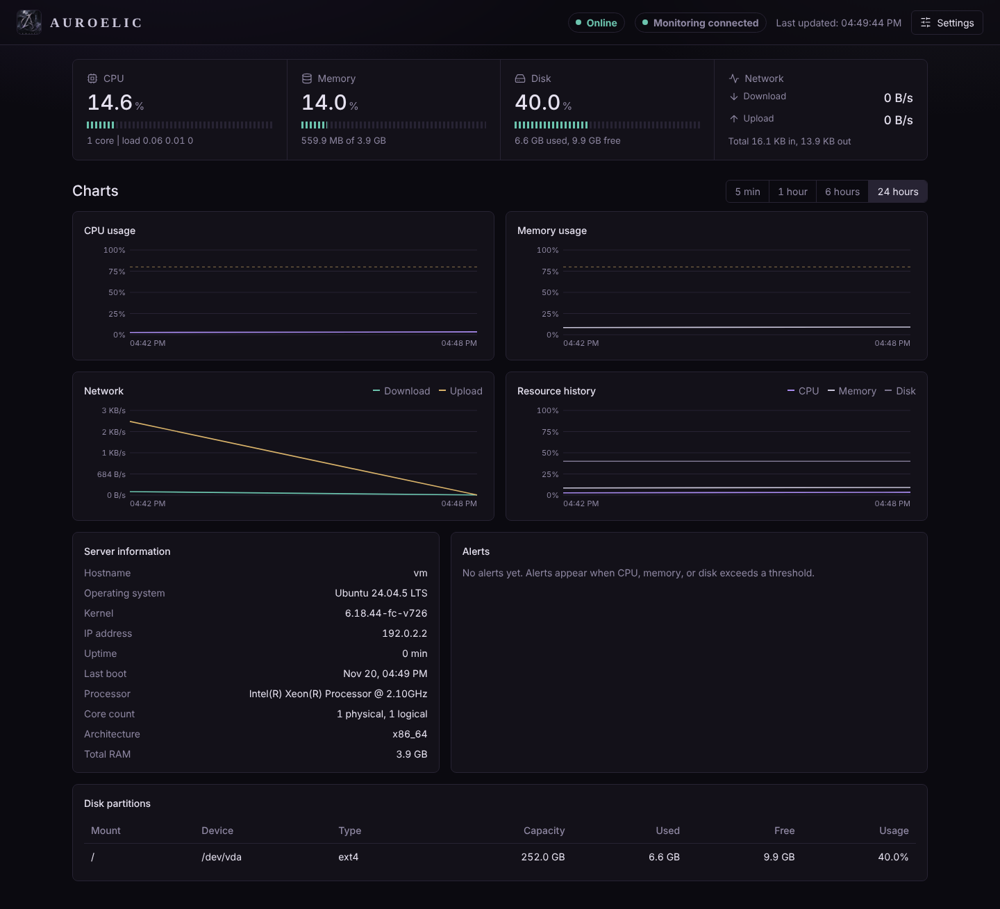
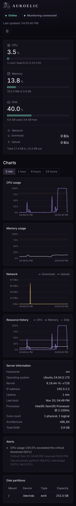

# Auroelic

Real-time server monitoring dashboard. The FastAPI + psutil backend reads data directly from the OS, the frontend is plain HTML/CSS/JS (no build step), data is pushed over WebSocket, and history is stored in SQLite.

## Screenshots

### Overview

### Active alert (real CPU load)

### Settings (alert thresholds)

### Time ranges
| 1 hour | 6 hours | 24 hours |
|---|---|---|
|  |  |  |

### Mobile

## Running
    cp .env.example .env     # adjust if needed
    ./run.sh                 # creates a venv, installs dependencies, starts the server
Open http://127.0.0.1:8000. For remote access, set `AUROELIC_HOST=0.0.0.0`, you MUST set `AUROELIC_TOKEN`, and place the server behind HTTPS (reverse proxy).

## API (use the `Authorization: Bearer <token>` header when a token is enabled)
- GET /api/health (no auth), /api/snapshot, /api/system, /api/history?range=5m|1h|6h|24h, /api/alerts?status=all|open|resolved&limit=
- GET/PUT /api/settings (warning/critical thresholds for CPU, memory, disk)
- WS /ws?token=...

## Structure
backend/app: config, collector (psutil), store (SQLite), alerts (engine), main (API/WS). frontend: index.html, style.css, app.js.

## Notes
- Used memory = total - available (excluding cache); disk percentage uses the `df` formula (used/(used+free)).
- Partitions that cannot be read are skipped, never faked. The cause of CPU/memory alerts is taken from the top processes.
